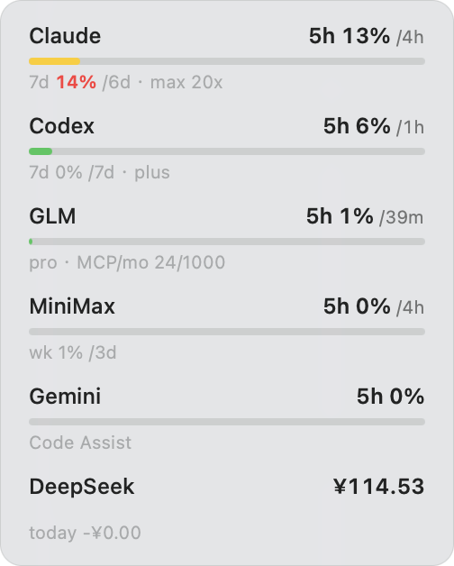
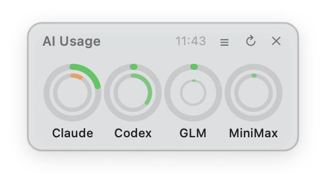

# usage-monitor

A native macOS always-on-top monitor showing usage across your AI subscriptions — Claude, Codex, Spark, Grok, Gemini, GLM, MiniMax, Qoder, CodeBuddy, DeepSeek — in one glance. On notched MacBooks, compact meters occupy the otherwise-unused menu-bar space immediately beside the camera.

| List mode | Ring mode |
|---|---|
|  |  |

## Why

Figuring out *"which AI should I use right now"* shouldn't be a query task — it should be peripheral vision.

- **Availability, not usage.** Raw percentages don't carry a decision. The panel shows what's left and how long until it comes back (adaptive countdowns: `3d`, `8h`, `2.5h`, `45m`), and pace-based colors answer the only question that matters: *at this burn rate, will the window survive until reset?* Green = go ahead, red = ease off.
- **Visual hierarchy mirrors information hierarchy.** The 5h window is what you act on — big, bold, bar / outer ring. Countdowns are smaller and dimmer. Weekly windows, MCP quotas and plan tiers are fine print / thinner inner rings. No icons, no decoration.
- **Ambient, not an app.** Always-on-top vibrancy panel, no Dock icon, never steals focus, auto-refreshes, remembers its position and view mode. All chrome (title, clock, buttons) stays hidden until you hover — at rest it's nothing but the data. Like the menu-bar clock: always there, always current, never managed.
- **Zero maintenance.** Credentials are reused from the CLIs you already log into; expired OAuth tokens refresh themselves. Install it, then forget it exists — except for the colors.

**Your subscriptions, one glance.**

## Features

- **Zero config**: reuses credentials your CLIs already saved (Claude Code keychain, `~/.codex/auth.json`, `~/.grok/auth.json`, `~/.gemini/oauth_creds.json`, opencode/hermes auth files). Providers without credentials are hidden automatically.
- **Self-healing OAuth**: expired Codex / Grok / Gemini access tokens are silently refreshed via their refresh tokens and written back — no more re-running CLIs just to query usage.
- **Pace coloring**: window color reflects burn rate vs. reset time (green = sustainable … red = will exhaust before reset), same algorithm as the Claude Code statusline.
- **Three complementary views**: the **list** carries exact used percentages, reset countdowns, and plan & quota details; the **ring strip** is a compact row of your chosen 4 providers, with the outer arc for the main window and the inner arc for weekly or MCP quota; the **bar strip** uses stacked horizontal meters. Cycle them with the view-toggle button (`◔` list → `▤` ring → `☰` bar), and pick providers via the `⚙` menu (up to 4, Reset Default to restore); mode and window position persist.
- **Remaining quota and consumption direction**: across macOS list rows, notch details, and the bar strip, **used quota is gray on the left; remaining quota is bright on the right**. Gray grows from left to right as quota is consumed. In rings, gray grows **clockwise from 12 o'clock**, and the bright arc shows what remains (full = unused, empty = exhausted). Both use the same green / yellow / orange / red palette, based on consumption pace or used-percentage thresholds. List and bar percentage labels still report used quota; ring hover percentages are explicitly marked `left`.
- **Hover-only chrome**: at rest the panel is just rings/rows; hovering grows a title bar out of the top edge (content never moves) with the clock, the view-toggle (`◔` list → `▤` ring → `☰` bar), a `⚙` provider picker, refresh `↻`, and `✕` to hide the panel — it retracts when the mouse leaves. The app never quits on its own: `✕` only hides, and a small **menu-bar gauge** toggles the panel back; the launchd agent self-heals across crashes and logout.
- **Notch-native layout**: on a notched MacBook, the default compact meters split around the camera as two frosted-glass wings (`NSVisualEffectView`, menu-bar material) with outer corners rounded and inner edges flush against the notch, so the pair reads as a single vibrancy island extending the hardware notch. Hovering either wing fuses it with a centered detail panel below into one continuous rounded rectangle (same frosted glass, width aligned to the wings' outer edges); the upper wings become a single-line toolbar (last update time plus refresh, source picker and hide actions) whose buttons stretch to fill the wing. With three or fewer providers, recent analysis or an inspiration card alternates in a full-width hero line above the detailed meters. Tight notch text uses `Ant` / `ZAI` aliases; detail rows omit reset slashes and align Claude's plan (`max 20x`) opposite its weekly window. Balance-only providers (DeepSeek) stack name / balance / today-spend vertically instead of overflowing. Lightweight local samples are retained for six hours only. The island re-snaps after display or scaling changes; displays without a notch keep the normal movable floating panel.
- Native NSPanel + vibrancy, no Dock icon, auto-refresh every minute, `↻` for manual refresh, hover for details.

## Install

```bash
git clone https://github.com/08mamba24/usage-monitor && cd usage-monitor
./install.sh        # compiles, starts, enables login autostart
```

Requirements: macOS 13+, Xcode Command Line Tools (`xcode-select --install`). No other dependencies — plain `swiftc` + system Python 3.

## Windows (frozen)

Windows development stopped on 2026-11-08. The existing implementation is retained; new Windows features and the proposed Acrylic shell are no longer planned.

A plain-Python compact alternative ships in the same repo: a draggable always-on-top strip — short name + usage + thin progress bar per provider, same pace colors as the macOS panel.

```powershell
git clone https://github.com/08mamba24/usage-monitor && cd usage-monitor
python win_monitor.py
```

Requirements: Windows 10/11 + Python 3.9+ from python.org (tkinter included, no third-party packages). Claude credentials come from `~/.claude/.credentials.json` (`claude login`); every other provider reads the same credential files as on macOS once the respective CLIs are installed and logged in. Hover a cell for details, drag to move (position is remembered), right-click to refresh or quit; auto-refreshes every 5 minutes. Cross-platform logic is unit-tested and runs on a real Windows runner via GitHub Actions (`.github/workflows/windows.yml`).

## Providers & credential sources

| Provider | Shows | Credentials from |
|---|---|---|
| Claude (Max/Pro) | 5h + 7d windows, plan & tier | macOS: Keychain (Claude Code login) · Windows/Linux: `~/.claude/.credentials.json` |
| Codex (ChatGPT) | 5h/monthly + 7d windows, plan | `~/.codex/auth.json`, auto-refreshed |
| Spark (Codex-Spark) | 5h + 7d windows, separate pool from Codex | same `~/.codex/auth.json`; hidden if the plan has no Spark quota |
| Grok (SuperGrok / Heavy) | weekly/monthly credits, plan | `~/.grok/auth.json`, auto-refreshed |
| Gemini (Code Assist) | quota used | `~/.gemini/oauth_creds.json`, auto-refreshed |
| GLM (z.ai coding plan) | 5h window, monthly MCP quota | `GLM_API_KEY` / opencode / hermes |
| MiniMax coding plan | 5h + weekly windows | `MINIMAX_API_KEY` / opencode / hermes |
| CodeBuddy (credits pool) | credits used % and combined remaining credits | CodeBuddy CLI session in `CodeBuddyExtension/Data/Public/auth/Tencent-Cloud.coding-copilot.info`; reopen the CLI when expired |
| Qoder (credits pool) | credits used %, plan expiry | `QODER_PAT` (Qoder → Settings → Integrations → Personal Access Token) |
| DeepSeek (prepaid) | balance + today's spend | `DEEPSEEK_API_KEY` / opencode |
| Custom endpoint | any percentage or used-vs-total | `CUSTOM_USAGE_URL` (+ optional token / path / name) → env |

API-key providers can be configured explicitly — see [`env.example`](env.example) → `~/.config/usage-monitor/env`. For BigModel accounts, set `GLM_BASE_URL=https://open.bigmodel.cn`; the default is `https://api.z.ai`. CodeBuddy reads its CLI session without refreshing or modifying it.

The custom-endpoint row is a catch-all for any local gateway or dashboard that exposes one JSON number: set `CUSTOM_USAGE_URL`, point `CUSTOM_USAGE_PATH` at a nested field holding either a 0–100 percentage or a `{"used", "total"}` pair, and it renders like any built-in subscription.

## Privacy & security

- **No tokens in this repo or its output.** Credentials are read at runtime from your local credential stores; the JSON cache contains only percentages and balances.
- The only embedded constant is the **public installed-app OAuth client ID** of codex CLI (the same one shipped in every copy of that open-source CLI); gemini-cli's client constants are extracted at runtime from your local gemini installation. Both are needed because refresh tokens are bound to the client that issued them.
- Everything talks directly to the official provider endpoints; nothing else is contacted.

## Uninstall

```bash
./install.sh --uninstall   # removes launchd agent; your credentials are untouched
```

## License

MIT
